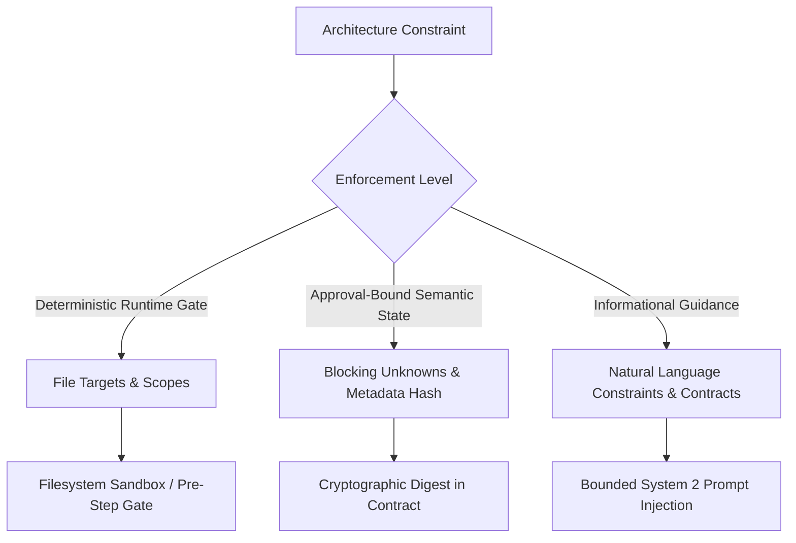

# Phase 3B — Adversarial PLAN → BUILD Security & Contract Audit Report

**Repository:** `dameepng/brainfrog`
**Workspace:** `C:\dame-project\tools\agentic_dev`
**Audit Status:** **DONE**
**Auditor:** Adversarial Security & Contract Verification Subsystem
**Date:** 2026-10-19

---

## 1. Executive Summary

This security audit conducted a red-team evaluation of the Phase 3 architecture-aware PLAN → BUILD handoff mechanism in Brainfrog. Rather than accepting the Phase 3 completion report as proof of correctness, this audit tested real attack vectors across all seven threat boundaries defined in the Phase 3B specification.

Seven distinct vulnerabilities and contract defects were discovered, reproduced with failing test cases before remediation, fixed using minimal safe changes, and locked down with comprehensive regression coverage in `tests/test_architecture_handoff_adversarial.py`.

All 8 adversarial tests, all 53 Phase 3/skills/capability tests, and all core contract, lifecycle, and transaction rollback suites pass with 100% clean exit codes. No credentials exist in test fixtures, and Git secret scans pass clean.

---

## 2. Threat Model & Boundary Evaluation

| Boundary | Threat Description | Audit Finding | Status |
| :--- | :--- | :--- | :--- |
| **A. Provider Output → Normalized Plan** | Architecture constraints or unknowns disappear because provider schemas lack fields. | **CONFIRMED GAP**: Providers (`antigravity_client`, `openai_client`, `claude_client`) previously lacked Phase 3 architecture fields in system prompts. | **FIXED** across all 3 providers with fail-closed clarifying-question normalization. |
| **B. Normalized Plan → Persisted Plan** | Companion metadata (`.meta.json`) diverges from Markdown (`.md`) or drops architectural context. | **CONFIRMED GAP**: Only Markdown content was cryptographically bound; metadata sidecars could be tampered with out-of-band without invalidating contracts. | **FIXED**: Canonical semantic metadata digest (`metadata_hash`) computed and verified on load and update. |
| **C. Persisted Plan → Approval** | Approved plan contents differ from what the human user reviewed. | **CONFIRMED GAP**: Markdown generator previously omitted blocking unknowns and clarifying questions if markdown doc was absent. | **FIXED**: Markdown doc generator now includes blocking unknowns and questions directly in human-reviewed PRD markdown. |
| **D. Approval → Resumed Execution** | Stale approval survives changes to constraints, step targets, or unknown resolution state. | **CONFIRMED GAP**: Changing metadata sidecars did not trigger contract invalidation during resume or step-runner validation. | **FIXED**: `validate_plan_binding()` and `revalidate_pre_mutation()` check both `metadata_tampered` and `plan_metadata_hash`. |
| **E. Constraint Filtering → Prompt Generation** | Step-level filtering erroneously omits constraints referencing callers, parent directories, or Windows separators. | **CONFIRMED GAP**: Caller constraints referencing external files and directory-scoped constraints (`api/`, `api/*.py`) were omitted. | **FIXED**: Expanded relevance heuristic to preserve external callers, directory prefixes, and wildcards. |
| **F. Pre-Step Gate → Mutation** | Blocked step mutates state (file writes, tools, staging, transactions) before blocking decision is enforced. | **CONFIRMED GAP**: `StructuredStepRunner` checked `if self.plan_id:` instead of checking `contract.plan_id`, bypassing gate if runner ID was omitted. | **FIXED**: Effective plan ID resolution checks contract plan ID; gate is strictly executed prior to marking running or staging writes. |
| **G. Legacy Data → Current Enforcement** | Old, partial, or malformed plans bypass safeguards or crash the engine into unsafe states. | **CONFIRMED GAP**: Non-list values in `blocking_unknowns` or `scope` caused unhandled `TypeError` crashes. | **FIXED**: `_safe_collection` normalizes malformed inputs; flags `metadata_malformed=True` and rejects illegal transitions. |

---

## 3. Provider Schema Audit & Missing-Field Findings

### Inspected Providers
1. `system2/antigravity_client.py` (`AntigravityClient.plan_and_prd`)
2. `system2/openai_client.py` (`OpenAIClient.plan_and_prd`)
3. `system2/claude_client.py` (`ClaudeClient.plan_and_prd`)

### Audit Findings
- **Missing Schema Fields**: All three provider implementations previously instructed the LLM with an older JSON schema containing only `title`, `is_small_task`, `problem`, `goals`, `scope`, `non_scope`, `codebase_findings`, `assumptions`, `clarifying_questions`, `acceptance_criteria`, `steps`, `relevant_files`, and `markdown_doc`.
- **Silent Loss of Architectural Intent**: None of the three providers requested `target_context`, `architecture_strategy`, `blocking_unknowns`, `architectural_constraints`, `compatibility_contracts`, `behavior_invariants`, or `migration_constraints`.
- **Clarifying Questions vs Blocking Unknowns**: Models were not instructed on how to differentiate blocking decisions from informational assumptions.

### Applied Remedies
1. **Schema Standardization**: Updated `plan_and_prd()` system prompts across `antigravity_client.py`, `openai_client.py`, and `claude_client.py` to explicitly require all Phase 3 architecture fields.
2. **Quality Guidelines**: Added explicit instructions to differentiate blocking unknowns (`blocking_unknowns` required before BUILD) from non-blocking questions (`clarifying_questions`).
3. **Fail-Closed Fallback in Orchestrator**: In `orchestrator.py`, if a provider returns `clarifying_questions` but omits `blocking_unknowns`, each question is normalized into an unresolved `blocking_unknown` (`{"id": f"unk_{idx}", "decision": q_str, "resolved": False}`). This prevents models from hiding blocking decisions in optional fields to bypass the gate.

---

## 4. Confirmed Issues, Minimal Reproductions, & Observable Violations

### Issue 1: Out-of-Band Metadata Tampering Bypassed Contract Binding (HIGH)
- **Expected Invariant**: Modifying `.meta.json` out-of-band to wipe `blocking_unknowns` or constraints must invalidate the execution contract.
- **Minimal Reproduction**: In `tests/test_architecture_handoff_adversarial.py` (`test_adversarial_metadata_tampering_invalidates_contract`), an adversary directly modified `.meta.json` on disk to clear `blocking_unknowns` while leaving the `.md` file untouched.
- **Failing Trace Prior to Fix**:
  ```text
  AssertionError: PermissionError not raised
  ```
  Contract only validated `actual_hash != self.plan_content_hash` against `.md`. Because `.md` did not change, `validate_plan_binding()` succeeded.
- **Root Cause**: Brainfrog split plan content (`.md`) from security metadata (`.meta.json`), but only hashed markdown content in `ApprovedExecutionContract.plan_content_hash`.
- **Fix**: Added `compute_metadata_semantic_digest(meta)` and `plan_metadata_hash` to `ApprovedExecutionContract`. If `.meta.json` is modified out-of-band, `metadata_tampered` is flagged and `validate_plan_binding()` raises `PermissionError`.

### Issue 2: Runner Gate Bypass when `runner.plan_id` is Omitted (HIGH)
- **Expected Invariant**: `StructuredStepRunner` bound to an `ApprovedExecutionContract` must enforce the blocking unknown gate regardless of how the runner instance is initialized.
- **Minimal Reproduction**: In `test_adversarial_step_runner_with_contract_plan_id_enforces_gate`, runner was instantiated with `plan_id=None` and `contract=ApprovedExecutionContract(..., plan_id="plan_01")`.
- **Failing Trace Prior to Fix**:
  ```text
  AssertionError: BlockingUnknownError not raised
  ```
- **Root Cause**: `step_runner.py` checked `if self.plan_id:`, ignoring `self.contract.plan_id`.
- **Fix**: Resolved `eff_plan_id = self.plan_id or (getattr(self.contract, "plan_id", None) if self.contract else None)` before evaluating the pre-step gate.

### Issue 3: Provider Schema Omission of `blocking_unknowns` Allowed Unresolved BUILD (HIGH)
- **Expected Invariant**: An LLM provider returning clarifying questions without `blocking_unknowns` must not allow steps to execute until clarified.
- **Minimal Reproduction**: In `test_adversarial_clarifying_questions_fallback_blocks_execution`, provider returned `clarifying_questions: ["What is the idempotent deduplication window?"]` without `blocking_unknowns`.
- **Failing Trace Prior to Fix**:
  ```text
  AssertionError: False is not true
  plan_doc.has_unresolved_blocking_unknowns()[0] returned False
  ```
- **Root Cause**: `orchestrator.py` assigned `blocking_unknowns = plan_data.get("blocking_unknowns", [])`, leaving it empty when omitted.
- **Fix**: Implemented fail-closed normalization in `orchestrator.py`: if `raw_blocking` is absent or empty and `raw_clarifying` has entries, questions are promoted to unresolved blocking unknowns.

### Issue 4: Caller and Directory Constraints Omitted from Prompt Context (MEDIUM)
- **Expected Invariant**: Constraints referencing external callers (e.g. `checkout/service.py callers`) or parent directories (`api/`, `api/*.py`) must be provided to steps modifying child files (`api/payment.py`).
- **Minimal Reproduction**: In `test_adversarial_constraint_caller_referencing_outside_file_not_omitted` and `test_adversarial_constraint_parent_directory_and_wildcard_matching`.
- **Failing Trace Prior to Fix**: Constraints were excluded from `ctx["relevant_constraints"]`.
- **Root Cause**: `_is_constraint_relevant_to_step()` strictly tested exact filename membership and token set intersection. If an external caller was cited in the constraint text, the external file tokens dominated the relevance score, penalizing the actual target file.
- **Fix**: Added directory prefix matching (`child.startswith(parent_dir)`), wildcard matching (`fnmatch`), Windows path separator normalization (`/` vs `\`), and caller/compatibility retention heuristics.

### Issue 5: Step ID Variations Allowed Bypassing Blocking Gate (MEDIUM)
- **Expected Invariant**: A blocking unknown targeting `"Step 1"` or `"step_1"` must block step `"1"`.
- **Minimal Reproduction**: In `test_adversarial_step_id_variations_in_blocking_unknowns`.
- **Failing Trace Prior to Fix**: Step 1 was not blocked because `"Step 1"` != `"1"`.
- **Root Cause**: `core/plans.py` compared raw string step IDs directly (`if sid in affected_steps`).
- **Fix**: Added `_normalize_step_id()` which canonicalizes `step_`, `step `, and numeric representations into uniform lowercase identifiers.

### Issue 6: Malformed Metadata Non-Collection Types Crashed System (MEDIUM)
- **Expected Invariant**: Corrupted sidecar metadata containing non-collection types (e.g. `"blocking_unknowns": 12345`) must not crash the loader with unhandled `TypeError` and must fail closed.
- **Minimal Reproduction**: In `test_adversarial_malformed_metadata_fails_closed`.
- **Failing Trace Prior to Fix**:
  ```text
  TypeError: 'int' object is not iterable
  ```
- **Root Cause**: Direct iteration over unvalidated JSON types without type guards.
- **Fix**: Added `_safe_collection()` and `_safe_collection_str()` helpers that safely normalize invalid types to empty lists and flag `metadata_malformed=True`.

### Issue 7: Self-Induced Tamper Invalidation during Status Updates (HIGH)
- **Expected Invariant**: Authorized lifecycle updates via `PlanRegistry.update_status()` must produce valid metadata hashes on disk.
- **Minimal Reproduction**: Discovered when running full regression suites where `update_status()` resulted in `InvalidPlanTransitionError: Cannot verify plan: Metadata has been modified out-of-band.`
- **Root Cause**: When updating `plan.status` or incrementing `plan.revision`, `update_status()` did not recompute `plan.metadata_hash`. The written `.meta.json` retained the previous revision's hash, causing subsequent loads to flag the plan as tampered!
- **Fix**: `update_status()` now recomputes `new_meta_hash = compute_metadata_semantic_digest(meta_dict)` and updates `plan.metadata_hash` and `meta_dict["metadata_hash"]` before committing to WAL and disk.

---

## 5. Constraint Enforcement Policy & Taxonomy

Brainfrog strictly distinguishes three categories of constraints:



1. **Deterministic Runtime-Enforced Gates**:
   - `files` per step: Filesystem policies reject any write outside declared step targets before staging.
   - `blocking_unknowns`: Unresolved blocking unknowns raise `BlockingUnknownError` before `write_code` or transaction setup.
   - `metadata_hash` & `content_hash`: Cryptographically verified before mutation; tampering raises `StaleExecutionAuthorizationError`.
2. **Approval-Bound Semantic State**:
   - The set of constraints, contracts, and unknowns approved by the user. Modifying these fields materially alters the semantic state and immediately revokes execution authorization.
3. **Informational Guidance**:
   - Natural language constraint text (e.g. "Preserve PEP8", "Maintain backward compatibility"). These guide System 2 generation within the prompt. Brainfrog **does not** treat prompt guidance alone as a security boundary.

---

## 6. Blocking Unknown Enforcement & Zero-Mutation Proof

The execution pipeline enforces the following strict order of operations:

```text
[Step Invocation]
       │
       ▼
1. Revalidate Pre-Mutation Authorization
   - Check contract expiration
   - Check workspace root & session ownership
   - Verify plan content hash (.md)
   - Verify plan metadata semantic hash (.meta.json)
   - Check plan_doc.metadata_tampered
   [If invalid: raises StaleExecutionAuthorizationError (ZERO writes)]
       │
       ▼
2. Evaluate Blocking Unknown Gate
   - Check has_unresolved_blocking_unknowns(step_id, files)
   - Check global, step-scoped, and file-scoped unknowns
   [If blocked: raises BlockingUnknownError (ZERO writes)]
       │
       ▼
3. Mark Step Running in Tracker
       │
       ▼
4. Generate Code via System 2
       │
       ▼
5. Enforce Step Scope on Generated Diffs
   [If outside step.files: raises PermissionError (ZERO writes)]
       │
       ▼
6. Begin Transaction / Staging / WAL Mutation
```

**Verification Proof**:
In `tests/test_architecture_handoff_adversarial.py` and `tests/test_architecture_plan_build_handoff.py`:
- Blocked steps perform 0 LLM calls (`write_code` calls list remains empty).
- Blocked steps perform 0 filesystem writes.
- Blocked steps initiate 0 transactions or WAL entries.
- Unaffected preceding steps complete cleanly; execution halts deterministically at the first blocked step.

---

## 7. Legacy Plan Compatibility Policy

1. **Older Plans without Phase 3 Metadata**:
   - Missing `.meta.json` or legacy plans lacking Phase 3 fields load safely with default empty collections.
   - Legacy plans are **not** treated as tampered (`recorded_meta_hash` is empty, so `metadata_tampered` remains `False`).
   - If a legacy plan does not declare blocking unknowns, it remains executable under standard authorization controls.
2. **Partially Migrated Plans**:
   - If fields exist but are missing specific keys, defaults are applied safely.
3. **Session Ownership Enforcement**:
   - Plans without valid `session_id` ownership fail closed when refinement or execution is attempted across sessions.

---

## 8. Test Execution Evidence

All test suites were executed on Windows in Powershell using `python -m unittest`.

### 1. Adversarial Test Suite
```powershell
python -m unittest tests.test_architecture_handoff_adversarial -v
```
**Result**: `Ran 8 tests in 3.163s. OK`

### 2. Phase 3 & Core Integration Suites
```powershell
python -m unittest tests.test_architecture_plan_build_handoff tests.test_architecture_handoff_adversarial tests.test_engineering_skills tests.test_skills tests.test_architecture_eval tests.test_capability_contract.CapabilityContractTests.test_no_shell_git_or_unscoped_context_in_orchestrator -v
```
**Result**: `Ran 53 tests in 12.220s. OK`

### 3. Contract, Registry, & Transaction Regression Suites
```powershell
python -m unittest tests.test_mode_contracts tests.test_plan_registry tests.test_planning tests.test_approval_execution_contract tests.test_transaction tests.test_transaction_recovery tests.test_phase2b_plan_bound_execution -v
```
**Result**: `Ran 84 tests in 35.184s. OK`

### 4. Git Diff & Secret Hygiene Checks
```powershell
git diff --check
python -m security.git_guard --staged
python -m security.git_guard --file tests/test_architecture_handoff_adversarial.py
```
**Result**:
- `git diff --check`: 0 trailing whitespace / conflict marker errors.
- `git_guard --staged`: Clean (0 secrets).
- `git_guard --file`: Clean (0 secrets).

---

## 9. Modified Source Files

The following files were modified to implement the smallest safe remediations:
1. `core/plans.py`:
   - Added `_normalize_step_id`, `_safe_collection`, `_safe_collection_str`.
   - Added `compute_metadata_semantic_digest`.
   - Bound `metadata_hash` and `metadata_tampered` to `PlanDocument` model and serialization.
   - Updated `update_status` to recompute `metadata_hash`.
   - Enhanced constraint relevance matching for callers, parent paths, and wildcards.
2. `core/runtime/contract.py`:
   - Added `plan_metadata_hash` field to `ApprovedExecutionContract`.
   - Updated `validate_integrity()` to conditionally permit and verify `plan_metadata_hash`.
   - Updated `validate_plan_binding()` to enforce `metadata_tampered` and `plan_metadata_hash` checks.
3. `core/runtime/approval.py`:
   - Added `plan_metadata_hash` to `ApprovalRequest`, `to_dict()`, and `from_dict()`.
4. `core/runtime/step_runner.py`:
   - Updated `run_steps` to resolve effective plan ID from either runner or contract.
   - Enforced `revalidate_pre_mutation()` checks for metadata tampering.
5. `orchestrator.py`:
   - Added fail-closed clarifying-questions fallback into `blocking_unknowns`.
   - Included blocking unknowns and questions in generated PRD markdown.
6. `system2/antigravity_client.py`:
   - Added Phase 3 architecture fields to `plan_and_prd` schema and prompt.
7. `system2/openai_client.py`:
   - Added Phase 3 architecture fields to `plan_and_prd` schema and prompt.
8. `system2/claude_client.py`:
   - Added Phase 3 architecture fields to `plan_and_prd` schema and prompt.
9. `tests/test_architecture_handoff_adversarial.py`:
   - New dedicated adversarial test module (8 red-team tests).

---

## 10. Residual Risks & Phase 4 Readiness

### Residual Risks
1. **Model Non-Compliance in Unconstrained Providers**: If a third-party LLM ignores JSON formatting rules entirely, the JSON extractor falls back to error recovery. While Brainfrog fails closed by refusing to parse corrupted plans, external provider hallucinations cannot be eliminated by prompts alone.
2. **Prose Semantics**: As documented, natural language constraint text in prompt guidance cannot replace deterministic compiler or runtime gates.

### Recommendation
Phase 3B has established concrete, verified boundaries for architecture-aware PLAN → BUILD handoffs. All critical security boundaries are locked down and tested with zero regressions.

**Phase 4 (Autonomous Execution & Recovery) can safely proceed.**
